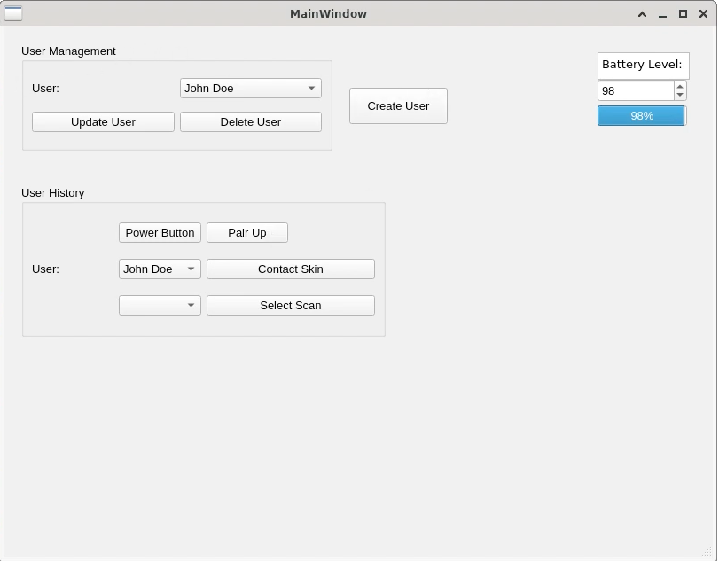
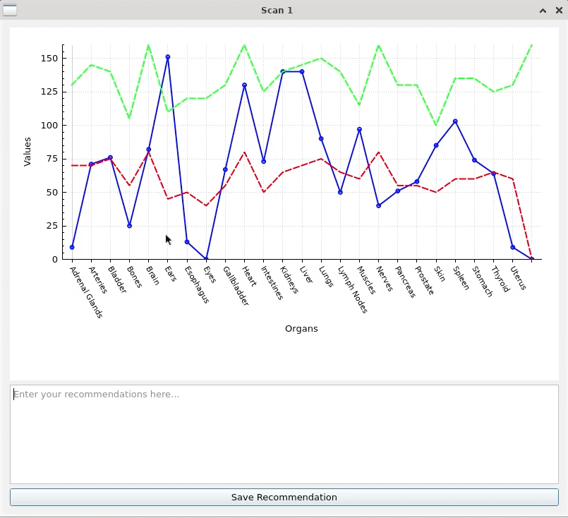
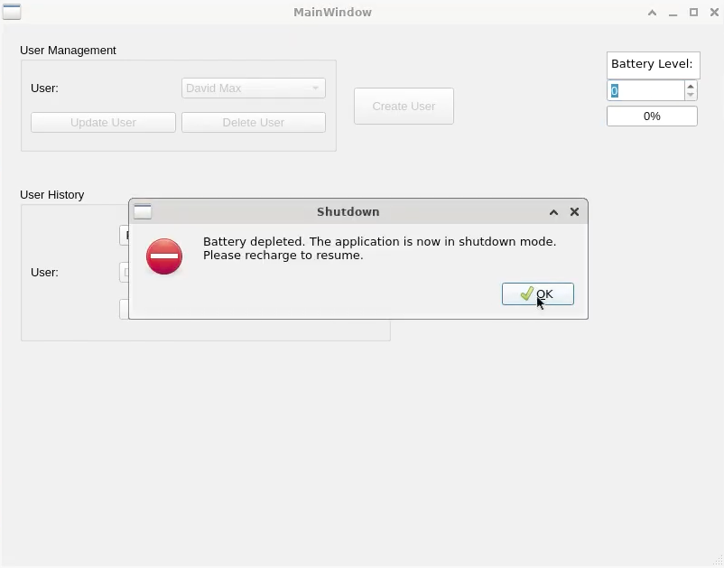

# RaDoTech Health Scanner Simulator

A desktop simulation of the **RaDoTech** health-scanning device, built in **C++ with Qt 6** as the final project for COMP 3004 (Object-Oriented Software Engineering) at Carleton University, Fall 2024.

The app simulates the full device workflow: create a user profile, power on and pair the device, take a 24-point meridian measurement, and review the results as a graph against healthy ranges for each organ.

▶️ **[Watch the demo](https://youtu.be/kOb9aWCoYd0)**

## Screenshots

| Main window | Scan results |
| --- | --- |
|  |  |

**Battery depletion:** when the battery hits 0%, the device locks the UI and shuts down gracefully.



## Features

- **User profiles**: create, update, and delete users, persisted to JSON between sessions
- **Device simulation**: power on/off, device pairing, and a battery that drains over time with low-power warnings and a graceful shutdown
- **24-point scan**: measures values across meridian points and stores each scan per user
- **Results visualization**: plots each organ's reading against its min/max healthy thresholds using QCustomPlot
- **Recommendations**: write and save notes against any scan
- **Full design docs**: use cases, UML class/sequence/state diagrams, and a traceability matrix in [`docs/`](docs/Design-Documentation.pdf)

## Tech

C++17 · Qt 6 (Widgets, PrintSupport) · QCustomPlot · JSON persistence · CMake / qmake

## Running it

**Qt Creator (easiest):** open `CMakeLists.txt` (or `src/finalProject.pro`) and hit Run.

**Command line:**
```bash
cmake -B build -DCMAKE_PREFIX_PATH=/path/to/Qt/6.x/macos
cmake --build build
```

## Architecture

| Class | Responsibility |
| --- | --- |
| `MainWindow` | Device state (power, pairing, battery), measurement flow, scan selection |
| `User` | Profile data and that user's saved scans |
| `CreateUserDialog` | Create/edit user profiles |
| `ScanPlotDialog` | Graphs a scan against organ thresholds, saves recommendations |

## Team

Built by Team 40:

- **Great Nnaji**: data persistence, power-on flow, 24-point measurement, scan selection, class and sequence diagrams
- **Muktar Akinbile**: GUI, graphing, battery, create/delete user
- **Abdul Azeem Vasiuddin Ahamed**: dialogs, device pairing, updating users, state diagram

Original team repo: [cloverzer0/3004Final_project](https://github.com/cloverzer0/3004Final_project)

*Plotting by [QCustomPlot](https://www.qcustomplot.com/) (GPL).*
